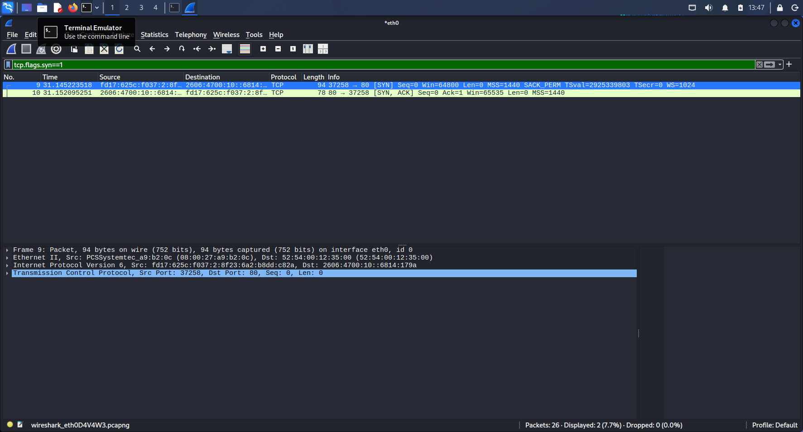
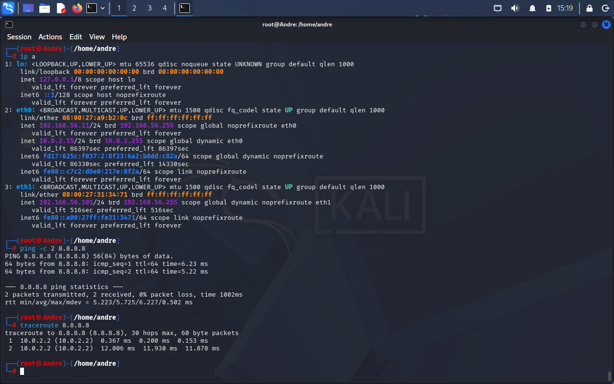
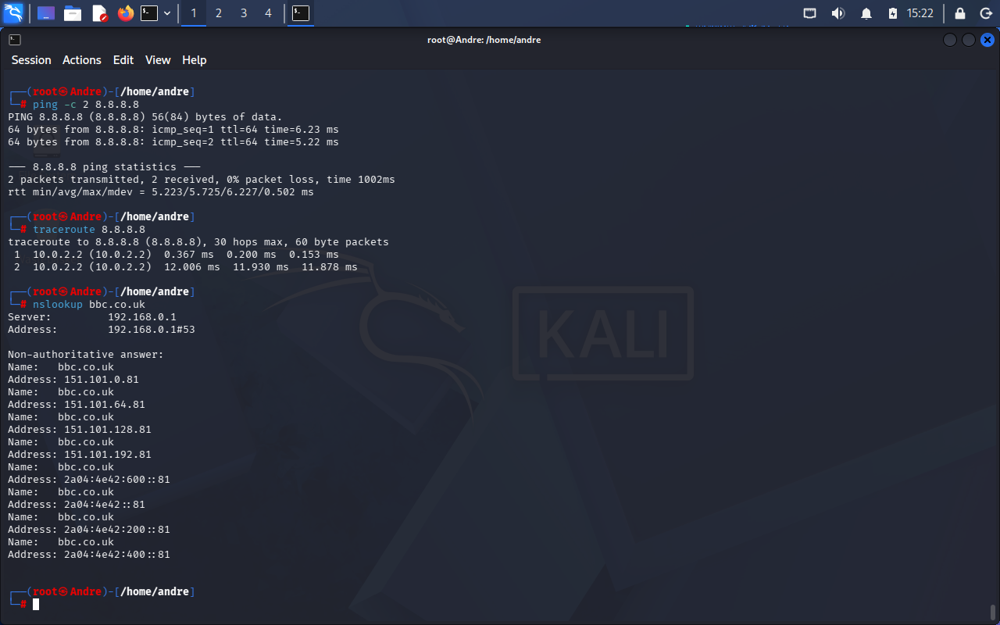
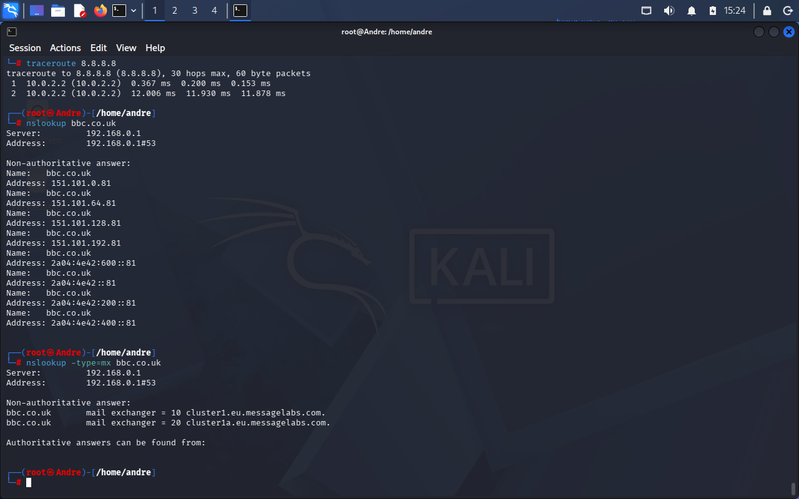
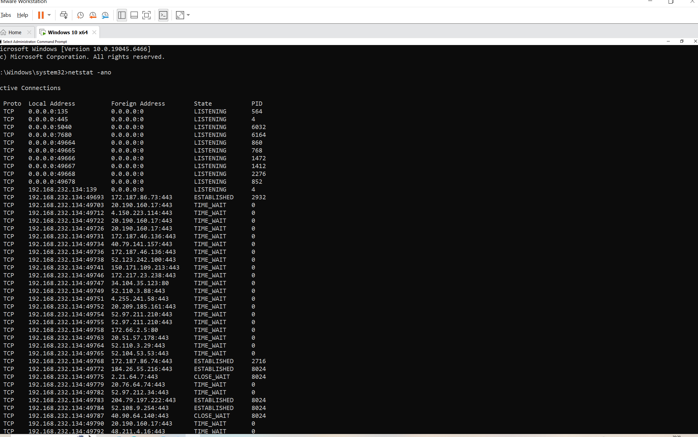
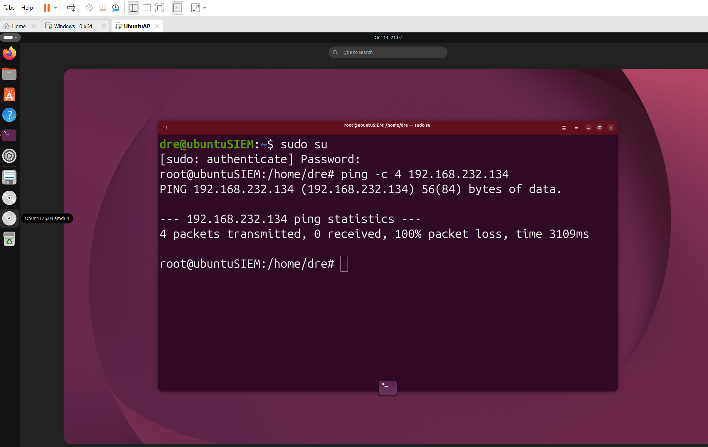
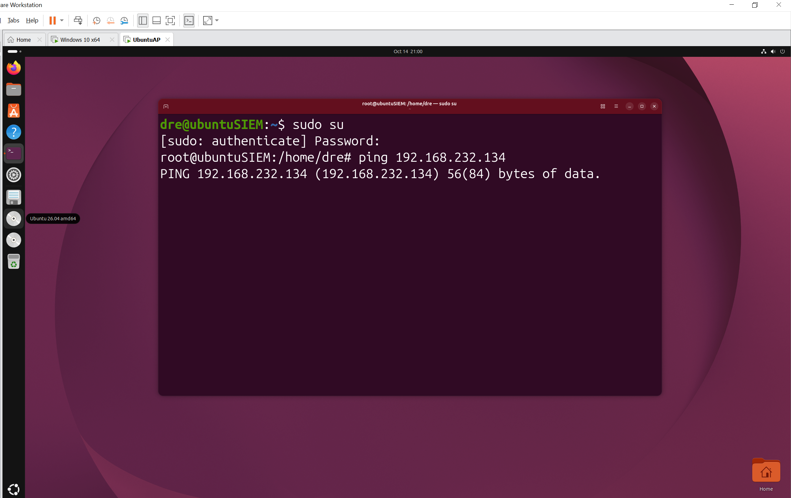
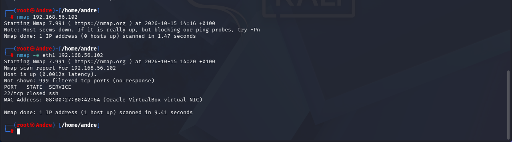

# Networking Fundamentals Lab

A hands-on lab demonstrating core networking and firewall concepts that underpin
day-to-day SOC work: how a TCP connection is built, how traffic is routed and
resolved, how to read a host's open ports, and how firewalls change what an
attacker can see. Every task was run in an isolated VM lab and documented with
evidence.

> **Why this lab:** these are the fundamentals behind alert triage and scanning —
> reading a packet capture, understanding ports and services, and recognising a
> firewall from the outside. Each task pairs a command with a short explanation
> and a screenshot.

--------------------------------------------------------------------------------------------------------------------------------------------------------------------------------------------

## Lab environment

| Role | Machine | Hypervisor | Purpose |
|--------------------|------------|------------|----------------------|
| Attacker / analyst | Kali Linux | VirtualBox | Capture, scan, probe |
| Target (Linux) | Ubuntu | VirtualBox | `ufw` firewall target |
| Target (Windows) | Windows 10 | VMware | Windows Firewall target |
| Second analyst | Ubuntu | VMware | Ping source for Windows task |

**Networking:** each VM had two adapters where needed — **NAT** (`10.0.2.x`) for
internet, and **Host-only** (`192.168.56.x`) for isolated VM-to-VM traffic.
Attacker and target were always kept in the **same hypervisor** so they could
reach each other.

**Tools used:** Wireshark, `traceroute`, `nslookup`, `netstat` / `ss`, Windows
Defender Firewall, `ufw`, Nmap.

--------------------------------------------------------------------------------------------------------------------------------------------------------------------------------------------

## Task 1 - TCP Three-Way Handshake (Wireshark)

**Shows:** how every TCP connection starts - SYN → SYN-ACK → ACK.

```bash
# Start a capture on the internet-facing interface, then:
curl http://example.com
# Stop the capture, then filter:
# tcp.flags.syn==1
```



The capture shows the client sending **[SYN]**, the server replying **[SYN, ACK]**,
and the client completing with **[ACK]** — the two machines agreeing to talk before
any data moves.

--------------------------------------------------------------------------------------------------------------------------------------------------------------------------------------------

## Task 2 — Trace the Path (traceroute)

**Shows:** the chain of routers ("hops") a packet crosses to reach a destination.

```bash
traceroute 8.8.8.8
```



Each numbered line is a router between the host and Google's DNS. TTL drops by one
at each hop, which is how traceroute maps the route.

--------------------------------------------------------------------------------------------------------------------------------------------------------------------------------------------

## Task 3 - DNS Resolution (nslookup)

**Shows:** how a name becomes an IP, and where a domain's mail is routed.

```bash
nslookup bbc.co.uk            # A record: name -> IP
nslookup -type=mx bbc.co.uk   # MX records: mail servers
```




DNS turns a name into an IP; MX records say where a domain's mail goes — the same
record types checked during phishing email analysis (SPF/DKIM/DMARC live in DNS).

--------------------------------------------------------------------------------------------------------------------------------------------------------------------------------------------

## Task 4 - List Listening Ports (netstat)

**Shows:** the "open doors" a machine is listening on, and its live connections.

```bat
netstat -ano        # Windows
```
```bash
ss -tulpn           # Linux equivalent
```



The **LISTENING** lines (e.g. `135`, `445`, `139` — RPC, SMB, NetBIOS) are services
waiting for connections, exactly what Nmap detects from outside. The **PID** column
maps each port to the process that owns it. Established/time-wait lines show live
connections, mostly to `:443` (HTTPS).

--------------------------------------------------------------------------------------------------------------------------------------------------------------------------------------------

## Task 5 - Windows Firewall: Block vs Allow

**Shows:** a firewall rule changing whether a host answers a ping (ICMP).

Setup on the Windows VM (`wf.msc` → Inbound Rules → New Rule → Custom → ICMPv4):

1. **Allow ICMP** → from the other VM, `ping` gets **replies**.
2. **Block ICMP** (or disable the allow rule) → the same `ping` **times out**.

```bash
ping -c 4 <windows-vm-ip>
```

**Allowed - replies return:**


**Blocked — request times out:**


> Note: Windows Defender Firewall **blocks ping by default**, so the demonstration
> is run as *allow (replies) → block (timeout)*. Rules were applied to **all
> profiles** (Domain/Private/Public) because the lab network is classed as Public.

The firewall alone decides whether the host is reachable — the machine itself
never changed.

--------------------------------------------------------------------------------------------------------------------------------------------------------------------------------------------

## Task 6 - Linux Firewall + Nmap (open vs filtered)

**Shows:** the strongest demonstration — a firewall flipping a port from
**open** to **filtered**, seen from a scanner.

On the Ubuntu target, open a port with a quick web server:
```bash
sudo python3 -m http.server 80   # leave running
```

**Before - scan from Kali (port 80 open):**
```bash
nmap -e eth1 192.168.56.102
```


Apply the firewall on Ubuntu:
```bash
sudo ufw enable
sudo ufw allow 22/tcp
sudo ufw deny 80/tcp
sudo ufw status verbose
```


**After - scan again (port 80 filtered):**
```bash
nmap -e eth1 192.168.56.102
```


What the before/after proves:

- **Port 80 flipped `open` → `filtered`** - the firewall now silently drops it.
- **Every port changed from `closed (reset)` → `filtered (no-response)`.** Without a
  firewall a closed port actively rejects with a RST; with `ufw` it drops packets
  silently. That shift is how an analyst spots a firewall in the path.
- **Port 22 shows `closed`, not `filtered`** - it was explicitly *allowed* through,
  so it's reachable; there's just no SSH service listening. Proof the allow-rule
  worked.

--------------------------------------------------------------------------------------------------------------------------------------------------------------------------------------------

## Troubleshooting (real problems solved along the way)

Getting the lab working surfaced several genuine networking issues, each a useful
talking point:

- **NAT vs Host-only:** VirtualBox NAT gives internet but blocks VM-to-VM traffic;
  Host-only connects the VMs but has no internet. The fix was giving Kali **two
  adapters** (NAT + Host-only).
- **Static IP vs DHCP:** a leftover static address (`192.168.56.11`) from an earlier
  lab kept overriding DHCP on boot — traced to a NetworkManager profile and cleared
  with `ip addr flush` / `dhclient`.
- **Dual-homed routing:** with that static address, Kali had *two* interfaces on the
  same subnet and sent probes out the wrong one ("Destination Host Unreachable").
  Fixed by forcing the correct interface with `ping -I eth1` / `nmap -e eth1`.
- **Cold boot vs reboot:** VirtualBox only re-reads adapter settings on a full
  power-off, not a guest reboot.

--------------------------------------------------------------------------------------------------------------------------------------------------------------------------------------------

## Skills demonstrated

TCP/IP fundamentals · packet capture and analysis (Wireshark) · DNS · routing and
`traceroute` · ports and services · host-based firewalls (Windows Defender Firewall,
`ufw`) · port scanning and interpreting scan states (open / closed / filtered) ·
network troubleshooting in a virtualised lab.
